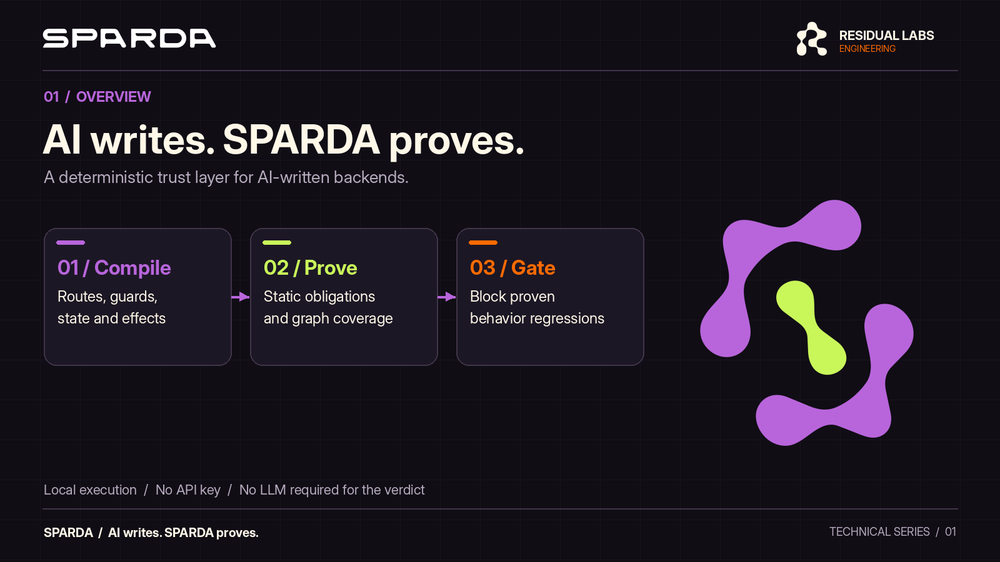
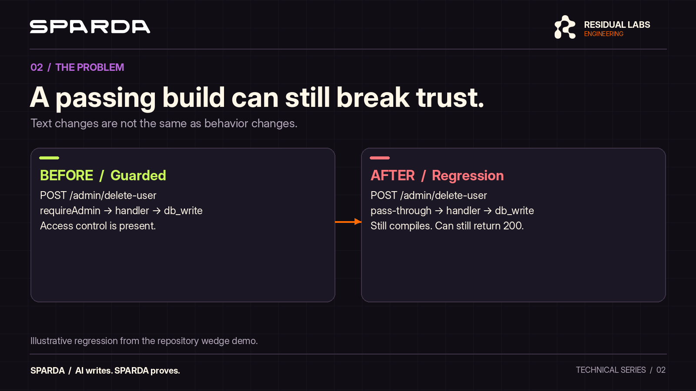
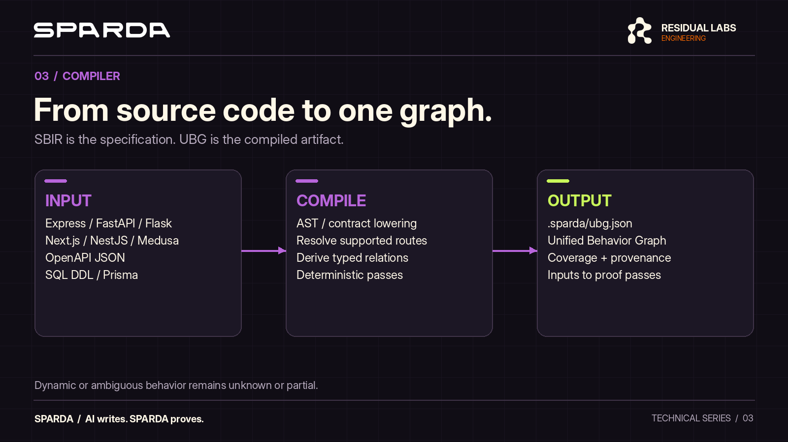
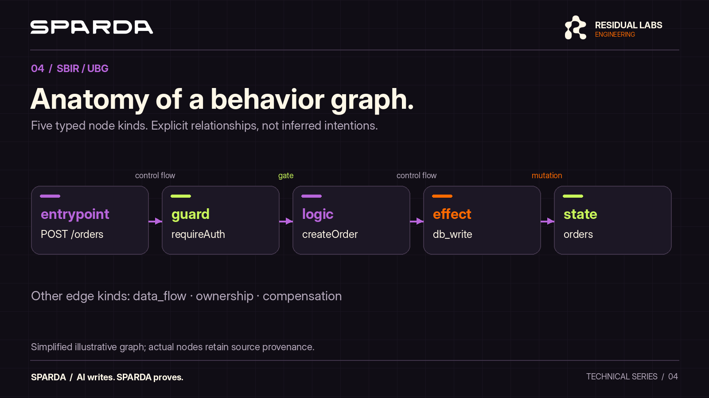
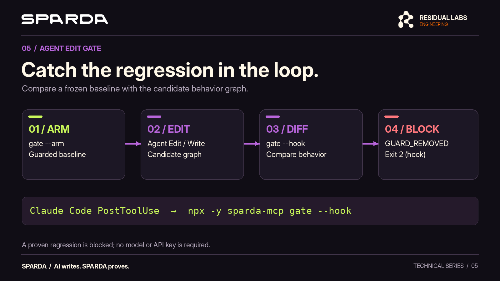
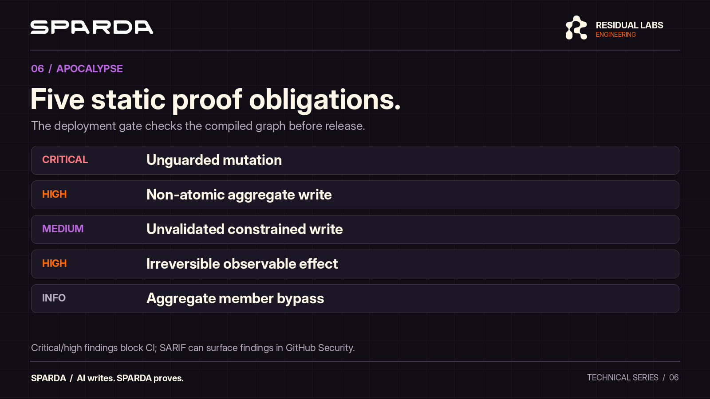
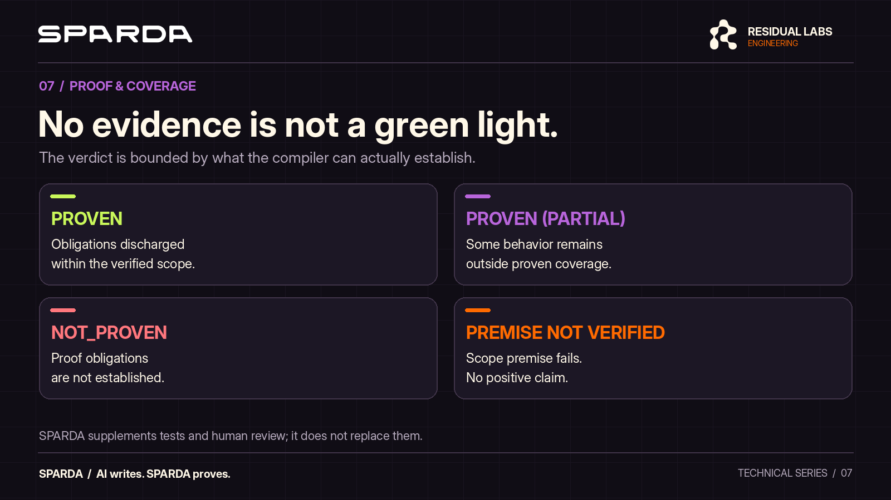
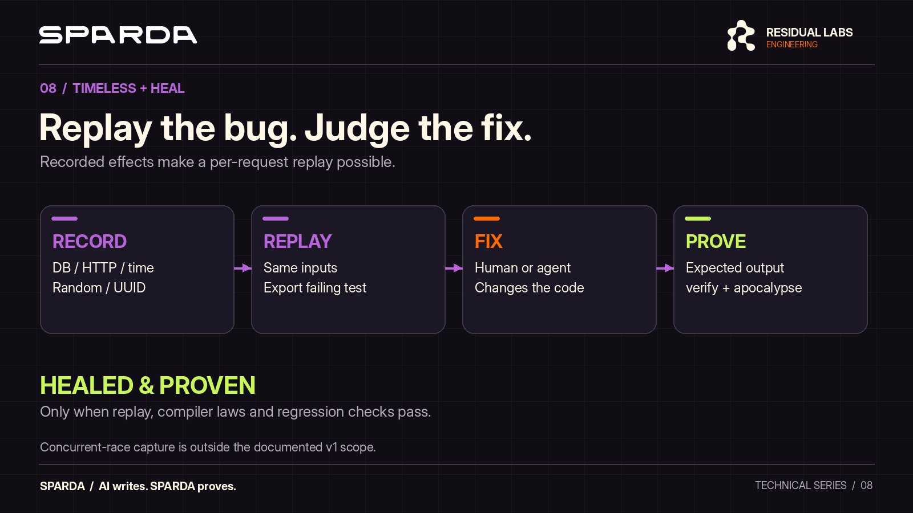
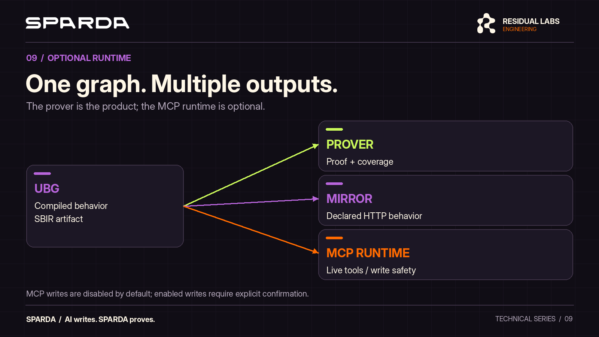
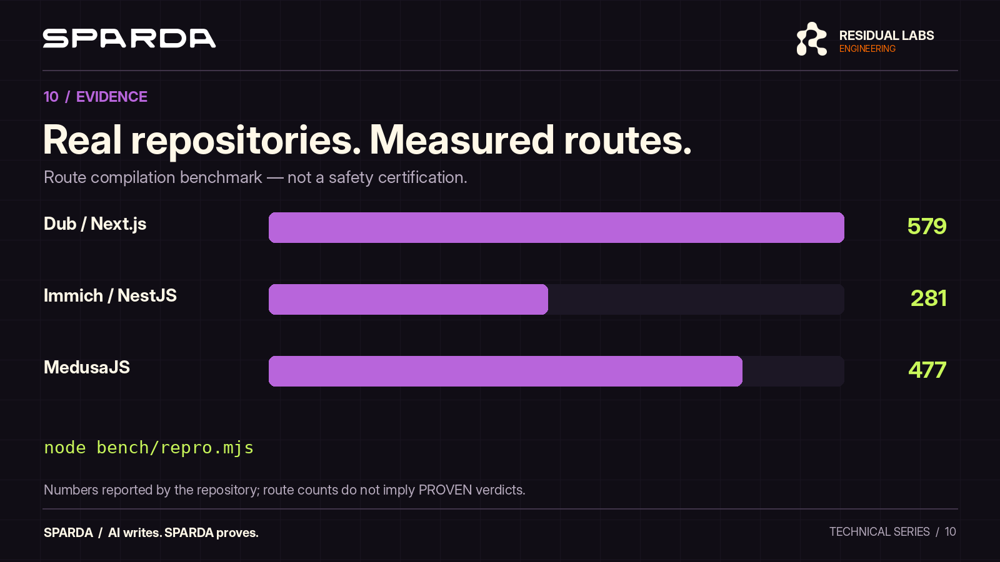

# SPARDA visual guide

[Project README](../../README.md) · [Guide en français](../../docs/SPARDA-EXPLIQUE.md) · [Benchmark data](../../bench/route-proof.json)

Ten illustrations from Residual Labs cover the compiler, the behavior graph and the checks that use it. The captions are bilingual. The artwork is in English.

| Illustration | Illustration |
| --- | --- |
|  |  |
|  |  |
|  |  |
|  |  |
|  |  |

The route counts describe compiler coverage in the recorded benchmark. Proof verdicts are reported separately for each repository. See the [benchmark protocol](../../bench/README.md) and [recorded results](../../bench/route-proof.json).

Les nombres de routes décrivent la couverture du compilateur dans ce banc. Le verdict de preuve est indiqué séparément pour chaque dépôt. [Protocole](../../bench/README.md) · [Résultats enregistrés](../../bench/route-proof.json)
